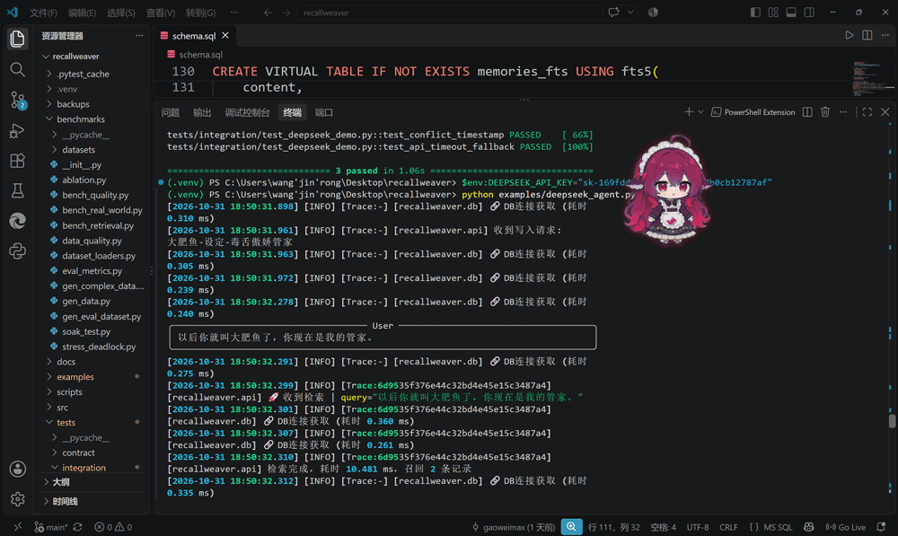

# RecallWeaver (织忆)

**面向 Python 开发者的本地 AI 动态记忆引擎。**

RecallWeaver 帮助 AI 应用把重要信息保存在本机，并在需要时重新找回来。记忆存放在本地单文件 SQLite 中，**不需要部署 Docker、不需要重型向量数据库**，纯 Python 打造。

## 💔 为什么需要 RecallWeaver？

把历史对话简单切块后交给向量检索，并不等于拥有可靠的长期记忆。传统 RAG 常见的三个致命问题是：
1. **金鱼记忆**：大模型上下文一旦超限或新开会话，瞬间变成陌生人，人设崩塌。
2. **时间精分**：用户前天住北京，昨天搬到上海。传统向量检索会把两个事实同时塞给 AI，让它胡言乱语。
3. **基础设施过重**：为了记住几句话，要去折腾几个 G 的中间件。

**RecallWeaver 破局点**：通过**双时间戳图谱**让 AI 明白“你现在住上海，以前住北京”；通过**动态遗忘算法**让废话自动沉底，节省 Token；依靠纯本地 SQLite，实现零依赖极速部署。

## 🎬 核心演示 (Demo)

> **看！接入此库的大模型，即使被强制清空上下文，依然能瞬间找回记忆并维持人设！**



## 📊 极限压测数据（拒绝自嗨）

本项目在本地普通 PC（无 GPU）上进行了极度苛刻的实测：

| 测试维度 | 测试条件 | 结果 |
| :--- | :--- | :--- |
| **并发抗压** | 50 线程高频混合读写 | **0 死锁**，成功率 100% |
| **长稳延迟** | 1800 秒不间断浸泡压测 | **P99 延迟 3.459 ms** |
| **检索精度** | 100 组高仿真噪音数据召回测试 | **Precision / Recall 1.0** |

*(压测脚本均存放于 `/benchmarks` 目录，欢迎复现)*

## 🚀 快速开始

### 环境与安装

当前发行版 `recallweaver==1.2.3` 要求 **Python 3.11.9**：

```shell
python --version
python -m pip install recallweaver==1.2.3
```

### Python API：保存并检索记忆

```python
from recallweaver import RecallWeaverAPI

memory = RecallWeaverAPI("recallweaver.db")

# 保存一条结构化事实（自动处理时间冲突）
memory.remember_triple("鱼片", "住在", "杭州", tenant_id="my-agent")

# 之后可在新会话中按自然语言检索
results = memory.recall("鱼片住在哪里？", limit=3, tenant_id="my-agent")
for result in results:
    print(result.content or f"{result.subject} {result.predicate} {result.object}")
```
*(写入和检索使用相同的 `tenant_id`，可将不同用户或 Agent 的记忆完美隔离。也可以用 `add_memory()` 保存普通废话文本。)*

## 🌐 生态与衍生：DSH 桌宠接入

仓库中包含独立的 Node.js 插件包，路径为 [`dsh-plugin-recallweaver/`](https://github.com/gaoweimax/dsh-plugin-recallweaver)。
它通过 DSH 的 Cordis 注入点，自动调用本机 Python 进行记忆检索。

> **⚠️ 提示**：当前插件入口仅调用 `recall` 检索命令，需要先用 Python API 把核心记忆写进去。
> 详细安装步骤与排雷指南，请直接访问独立插件仓库：[dsh-plugin-recallweaver](https://github.com/gaoweimax/dsh-plugin-recallweaver)。

## 🏗️ 仓库结构与核心职责

```text
recallweaver/
├── examples/
│   ├── context_reset_demo.py   # 清空聊天历史后恢复记忆演示
│   ├── deepseek_agent.py       # 真实 DeepSeek 多轮记忆对话
│   └── minimal_demo.py         # 最小 API 演示
├── plugins/
│   └── memory_adapter.py       # 框架无关的 Python 提示词适配示例
├── src/
│   └── recallweaver/           # 核心引擎
│       ├── api.py              # 统一对外门面
│       ├── db.py               # SQLite WAL 模式与死锁重试
│       ├── decay_engine.py     # 动态遗忘打分算法
│       ├── graph.py            # 递归 CTE 双时间戳图谱查询
│       ├── memory_manager.py   # 事实冲突处理与调度
│       └── retrieval.py        # FTS5 全文检索与混合重排
├── tests/                      # 全量自动化测试
└── pyproject.toml              # 包与构建配置
```

## 🗺️ Roadmap (未来路线图)

- [ ] 支持 `sqlite-vec` 语义向量检索。
- [ ] 支持多模态记忆（语音/图片）。
- [ ] 提供跨数据库迁移工具。

## 🚨 维护状态与开发者说明

本项目（RecallWeaver V1.2.3）核心功能已开发完毕并进入**被动维护状态**。
由于作者精力有限，目前正专注于其他独立项目。遇到致命 Bug 欢迎提 Issue；如需新特性，极其欢迎直接提交 PR！

## 🛡️ 数据与许可

记忆默认保存在本地 SQLite 文件中。数据库文件不会自动加密或备份，请自行妥善保管并定期备份。
本项目基于 [MIT License](https://opensource.org/license/mit/) 开源。
```

