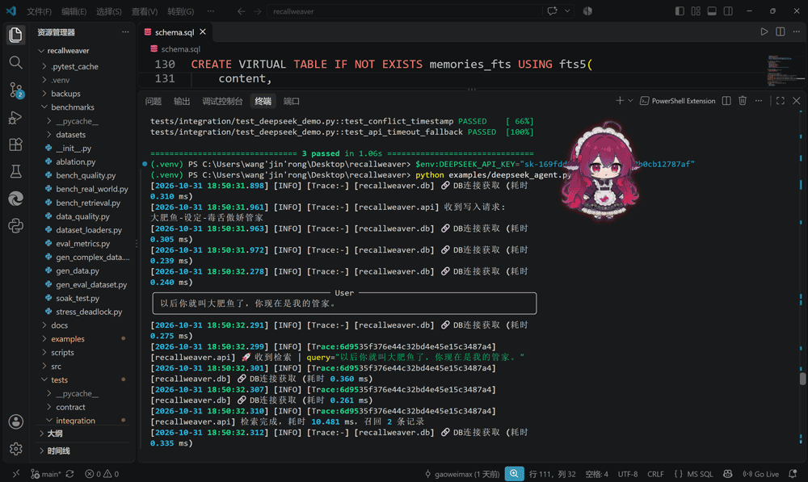
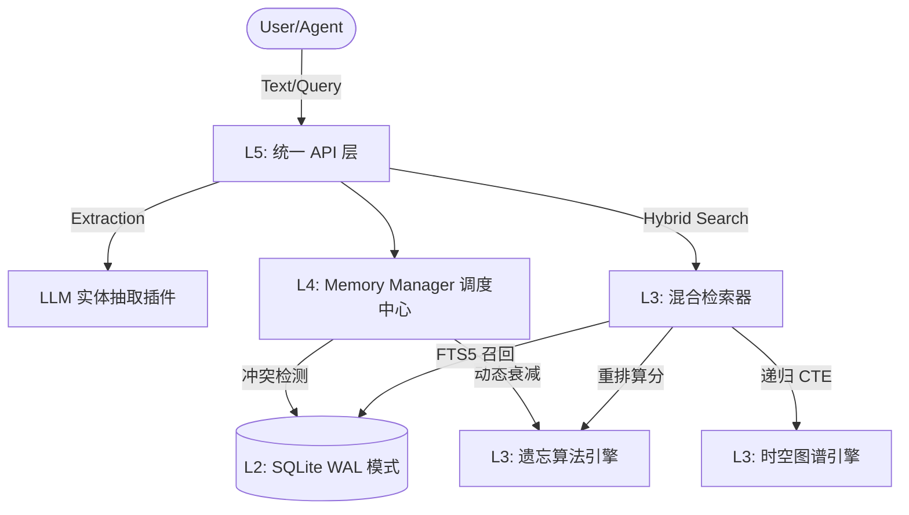

🧠 RecallWeaver (织忆)

**赋予 LLM Agent 穿越时间的记忆能力**

[](#)
[](https://www.python.org/)
[](#)
[](#)
[](https://opensource.org/licenses/MIT)

**Zero Docker. Zero Vector DB. Just pure SQLite & Python.**

[核心痛点](#-行业痛点与破局) · [架构设计](#-核心架构) · [快速开始](#-快速开始) · [API 示例](#-api-使用指南) · [性能基准](#-性能基准)

</div>

---

## 🎬 极客演示 (Demo)

> 以下是在真实 DeepSeek 接入下，AI 拥有长期记忆并维持“毒舌”人设的高光时刻：



---

## 💡 行业痛点与破局

当前主流的 AI 记忆方案（如传统 RAG）陷入了“堆砌硬件”的泥潭。为了记住一句话，你需要部署沉重的向量数据库（Milvus/Qdrant）、图数据库（Neo4j），消耗海量 Token，但依然解决不了以下致命问题：

- ❌ **时间逻辑混乱**：用户昨天说“我住在北京”，今天说“我搬到上海了”。传统 RAG 会把两个事实同时塞给大模型，导致 AI 精神分裂。
- ❌ **金鱼记忆效应**：缺乏遗忘机制，无用闲聊挤占了宝贵的上下文窗口。
- ❌ **黑盒检索**：向量相似度召回经常给出似是而非的废话，且不可解释。

**RecallWeaver（织忆）的破局之道：**
我们不依赖任何重型基础设施，仅用单文件 SQLite 与 100% 纯 Python，手搓了一套符合人类大脑运作规律的记忆引擎。**它像海马体一样接管 AI 的记忆，决定什么该记住，什么该遗忘，以及事实是如何随时间演变的。**

---

## ✨ 核心高光特性 (Highlights)

### 🕰️ 双时间戳与时空图谱 (Spatio-Temporal Graph)
基于底层的 `valid_from` 与 `valid_to` 字段，我们实现了**事实的版本控制**。
当冲突发生时（如“张三从北京搬家到上海”），旧事实不会消失，而是被标记为失效。AI 随时可以进行“时间旅行”，回答“他以前住哪”以及“他现在住哪”。

### 📉 动态遗忘打分池 (Dynamic Decay Pool)
记忆不是死板的硬盘，而是会随时间的流逝而衰减。
基于指数衰减公式 `score = base · e^(-λΔt) · (1+αn)^β`，高频召回的记忆会获得权重加成，长时间不用的冷数据自动沉入“冷库”。**极大节省了 Token 消耗，让 AI 真正学会“抓重点”。**

### ⚡ 混合检索与可解释性 (Hybrid & Explainable Retrieval)
结合 SQLite FTS5 全文索引（关键词精准命中）与递归 CTE 图谱遍历（多跳关系召回），并进行二级衰减重排。每一条召回结果都附带明确的“来源”与“分数”，彻底告别黑盒。

### 📦 极致的轻量化与工程化 (Zero-Dependency Engineering)
拒绝繁琐的微服务。纯 Python 3.11+ 编写，100% 依赖注入，内置 Pydantic 强数据校验。**无需 Docker，单机可跑，直接嵌入你的本地脚本。**

---

## 📊 性能基准 (Benchmarks)

在普通消费级 PC 环境（无 GPU）下，对 **100,000 条** 历史记忆进行极限压力测试：

| 指标 | 数据 |
| :--- | :--- |
| **测试数据量** | 100,000 条结构化/非结构化记忆 |
| **查询延迟 (P95)** | **2.63 毫秒** （比人类眨一次眼睛快 100 倍） |
| **内存占用** | 极低（惰性加载机制） |

---

## 🏗️ 核心架构



---

## 🚀 快速开始

### 1. 环境准备
需要 **Python 3.11** 或以上版本。

### 2. 安装与初始化
```bash
# 克隆项目
git clone https://github.com/gaoweimax/recallweaver.git
cd recallweaver

# 创建并激活虚拟环境 (Windows)
python -m venv .venv
.venv\Scripts\activate

# 安装依赖包及项目本体
pip install -e .
```

### 3. 配置环境变量 (可选)
新建 `.env` 文件，配置你的数据库路径和大模型 API Key（用于自动实体抽取）：
```env
RECALLWEAVER_DB_PATH=./recallweaver.db
LLM_API_KEY=your_deepseek_api_key
```

---

## 🛠️ API 使用指南

### 场景一：纯文本记忆与混合检索
```python
from recallweaver.api import RecallWeaverAPI

# 初始化 (自动检测并建表)
api = RecallWeaverAPI(db_path="recallweaver.db")

# 存入非结构化记忆
api.add_memory("今天广州很热，我想吃点冰的。")

# 混合检索 (FTS5 + 衰减重排)
results = api.recall("推荐点吃的", limit=3)
for res in results:
    print(f"[Score: {res.score:.2f}] {res.content}")
```

### 场景二：事实演变与“时间旅行”
```python
# 1. 记录过去的事实
api.remember_triple(subject="张三", predicate="住在", object_="北京")

# 2. 记录新事实（系统自动检测冲突，将北京标记为 valid_to，上海写入 valid_from）
api.remember_triple(subject="张三", predicate="住在", object_="上海")

# 3. 查询当前有效事实
current = api.graph.query_multi_hop("张三")
# 结果: 张三 -> 住在 -> 上海

# 4. 回溯历史轨迹（时间旅行）
history = api.get_history(subject="张三", predicate="住在")
# 打印结果:
# [当前有效] 上海 (valid_from: 2026-10-30...)
# [已失效]   北京 (valid_to: 2026-10-30...)
```

---

## 📂 项目结构

```text
recallweaver/
├── src/recallweaver/
│   ├── api.py              # L5: 统一门面接口，屏蔽底层复杂度
│   ├── config.py           # L1: Pydantic-Settings 环境配置
│   ├── errors.py           # L1: 标准化异常体系 (RW-XXX)
│   ├── db.py               # L2: SQLite 连接池、WAL 与事务封装
│   ├── models.py           # L4: 强类型 Pydantic 数据校验
│   ├── memory_manager.py   # L4: 核心调度与双时间戳冲突处理
│   ├── decay_engine.py     # L3: 动态遗忘指数衰减算法 (纯函数)
│   ├── retrieval.py        # L3: FTS5 全文召回与重排
│   ├── graph.py            # L3: 递归 CTE 多跳图谱引擎 (防环机制)
│   └── extraction/         # L5: 实体抽取插件 (LLM / Regex)
├── tests/                  # Pytest 单元/集成/契约测试
├── benchmarks/             # 10 万级数据压力测试脚本
└── examples/               # 端到端跑通的最小 Demo
```

---

## 🧪 开发与测试

我们坚持测试驱动（TDD），保证核心算法的绝对稳定。

```bash
# 运行 100% 覆盖率的全量测试
pytest -v

# 运行性能基准测试
python benchmarks/bench_retrieval.py
```

## 🤝 贡献指南

我们极其欢迎 Issue 和 PR！
1. Fork 本仓库并 Clone 到本地。
2. 创建新的分支：`git checkout -b feature/amazing-feature`。
3. 提交你的修改：`git commit -m 'feat: add some amazing feature'`。
4. 推送并提交 Pull Request。

## 📄 开源协议

本项目基于 **[MIT License](LICENSE)** 协议开源。你可以自由地用于商业项目、闭源分发或二次开发，只需保留原作者版权声明。
```
