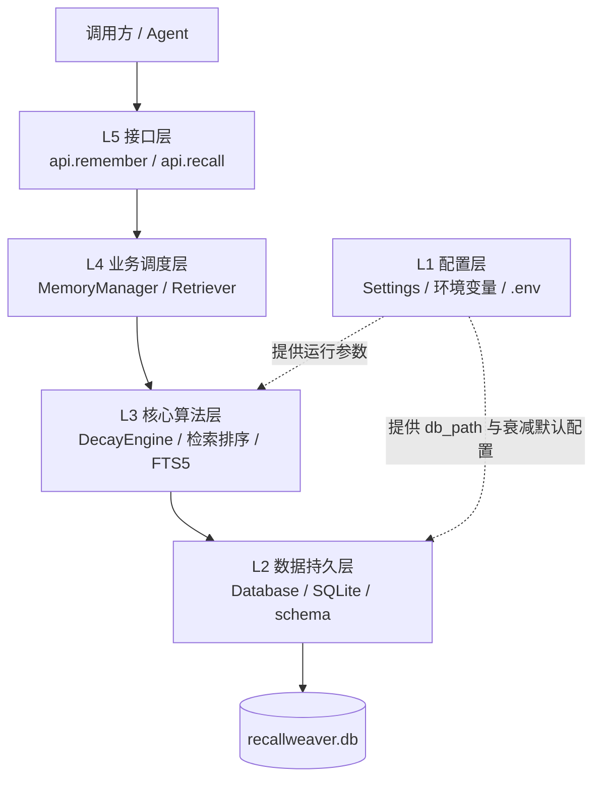
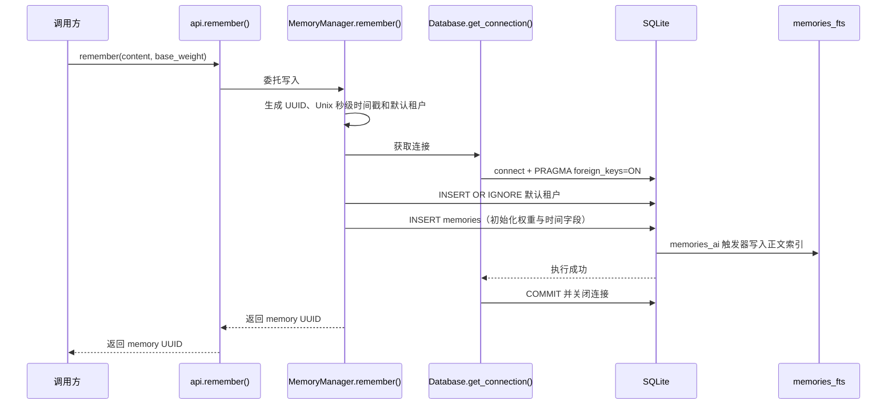

# RecallWeaver 系统架构设计

## 1. 系统目标与边界

RecallWeaver 是一个运行在 Python 进程内的轻量级记忆存储与检索组件。它将记忆正文、实体关系、有效时间和检索索引保存在本地 SQLite 数据库中，不要求独立数据库服务、向量数据库或图数据库。公开 API 提供记忆写入和关键词召回；更复杂的实体抽取、关系建模及语义检索可由上层应用或扩展模块承担。

## 2. 五层结构

| 层级 | 主要职责 | 当前实现 |
|---|---|---|
| L1 配置层 | 集中管理数据库位置及运行参数，允许用环境配置覆盖默认值。 | `config.py` 中的 `Settings`；默认数据库路径为 `recallweaver.db`，默认衰减系数为 `0.01`。 |
| L2 数据库层 | 建立 SQLite 连接、启用外键约束、执行 schema 或版本迁移，并将 SQLite 错误转换为存储错误。 | `db.py`、`migrations/runner.py`、`schema.sql` 与 `migrations/0001_init.sql`。 |
| L3 核心算法层 | 执行全文检索、关键词匹配及记忆衰减分数的计算；维护 FTS5 内容索引。 | `retrieval.py`、`decay_engine.py`；FTS5 同步由数据库触发器完成。 |
| L4 业务调度层 | 组织记忆写入、冲突失效、候选检索、实时评分与结果排序。 | `memory_manager.py`、`retrieval.py`。 |
| L5 接口层 | 提供稳定、简单的 Python 调用入口，并将具体实现委托给业务层。 | `api.py` 导出的 `remember()` 与 `recall()`。 |

各层通过模块边界协作。数据库连接由 `Database.get_connection()` 上下文管理器负责关闭和事务提交；操作异常会显式转换为 `StorageError`，而不是由接口层自行拼接 SQL。

## 3. `api.remember()` 数据流

下图展示默认公开写入 API 的完整路径。SQLite 的 `memories_ai` 触发器在同一数据库写事务中同步 FTS5 索引。

如果事务中的 SQLite 操作失败，连接上下文会回滚，并以 `StorageError` 报告失败；调用方不会收到成功形态的记忆 ID。

## 4. 检索与降级路径

`api.recall(query, limit)` 将调用委托给 `Retriever.search()`。检索首先尝试通过 `memories_fts` 执行 FTS5 `MATCH` 查询，并限制候选集规模；当 FTS5 查询报错或没有命中时，改用 `content LIKE '%query%'` 进行子串兜底。LIKE 路径对中文等不适配当前 FTS 分词配置的输入更有机会取得结果，但属于较慢的匹配方式。

候选记录的实时衰减分数在 Python 层计算，随后按分数降序排列并应用调用方的 `limit`。FTS5 是加速及英文/分词检索路径，不是数据的唯一存储；正文仍保存在 `memories` 表中。

## 5. 核心机制

### 5.1 FTS5 检索降级

FTS5 虚拟表以 `memories` 为外部内容表，并由插入、更新和删除触发器保持正文同步。检索时优先使用倒排全文索引，避免对全部正文逐条执行字符串匹配。当全文查询异常或无结果时，检索器使用 LIKE 兜底，提升对不适配 FTS tokenization 的查询的兼容性。该降级提高可用性，但不保证 LIKE 具有 FTS5 的性能，也不等同于语义向量检索。

### 5.2 双时间戳与冲突保留

`memories.valid_from` 和 `memories.valid_to` 表示某条事实在业务世界中的有效区间；`memories.tx_time` 记录该记忆首次写入数据库的时间。发生冲突时，业务层将旧记录标记为 `expired` 并设置 `valid_to`，同时插入新记录，而不是覆盖旧正文。由此保留旧事实及其有效区间，便于区分“事实何时成立”与“系统何时记录它”。

当前 schema 为每条记忆保存写入时间点，不保存完整的事务时间区间或每次修改快照。因此它提供业务有效时间和初始写入时间，不应被视为具备完整历史版本审计能力的通用双时态数据库。

### 5.3 惰性衰减

记忆分数在被读取或参与检索时根据时间差实时计算，不要求后台定时任务遍历并改写所有记录。检索路径仅对实际候选记录做计算，未被访问的记录无需周期性 I/O。`decayed_weight` 与 `last_decay_at` 字段用于保存衰减状态；当前公开检索路径使用 `DecayEngine.calculate_score()` 根据记录中的基准权重、系数、上次衰减时间和检索次数计算分数。

## 6. 持久化对象概览

核心业务表包括租户 `tenants`、事件来源 `episodes`、记忆 `memories`、实体及别名 `entities` / `entity_aliases`、实体三元组 `edges`、记忆关系 `memory_edges`、检索审计 `retrieval_logs` 和迁移版本 `schema_migrations`。字段、约束及索引详情见[数据字典](data_model.md)。

## 7. 初始化与迁移

数据库连接由 `Database` 管理，连接时显式启用 `PRAGMA foreign_keys = ON`。项目提供 `schema.sql` 初始化脚本和按版本记录的迁移执行器；初始迁移为 `migrations/0001_init.sql`。部署或启动代码应采用项目入口所对应的初始化/迁移流程，避免在生产数据库上手工修改结构。
