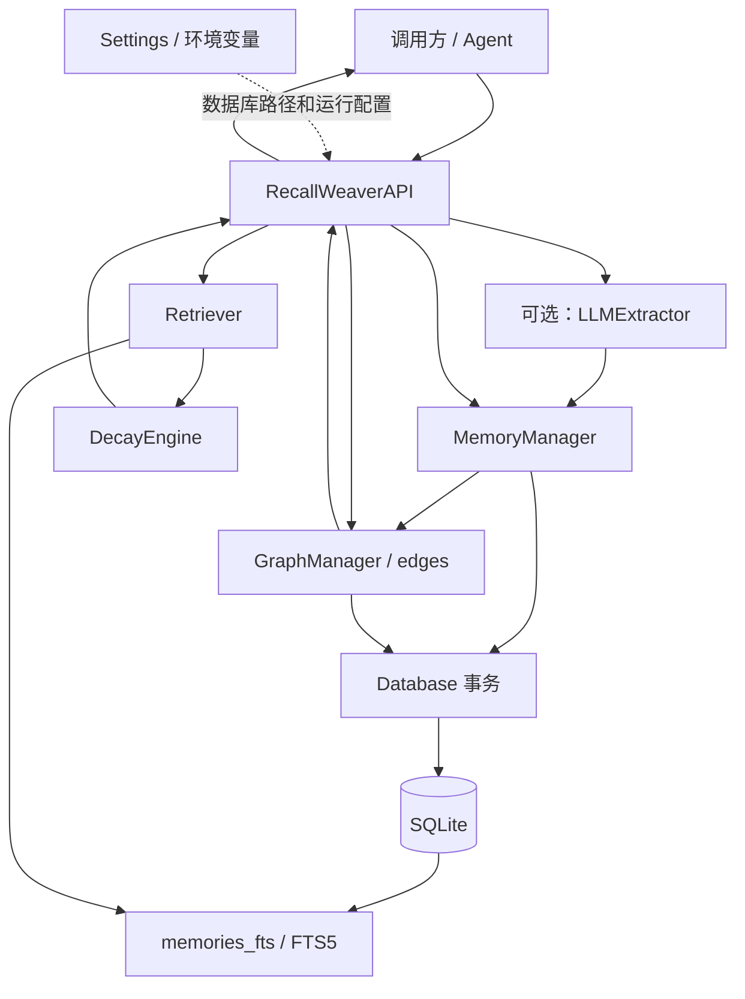
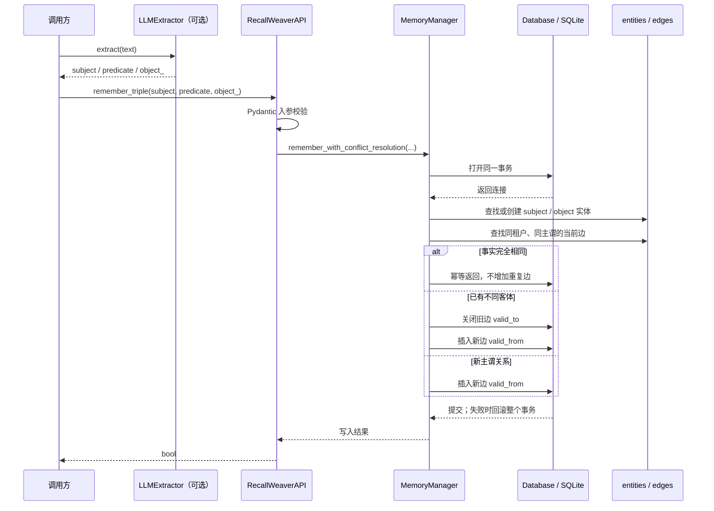
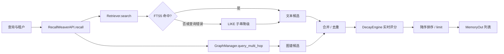

# RecallWeaver 系统架构

## 1. 范围与运行模型

RecallWeaver 是嵌入 Python 应用的本地记忆组件。API、业务逻辑、图关系、全文索引和数据存储运行在同一进程与 SQLite 数据库中，无需常驻数据库服务。`RecallWeaverAPI` 为主要对外门面；LLM 抽取器是可选组件，调用方可在写入前使用它把自然语言转换为三元组。

## 2. 分层结构

| 层级 | 责任 | 主要模块 |
|---|---|---|
| L1 配置 | 读取数据库路径、服务密钥及算法参数；默认值可由环境变量和 `.env` 覆盖。 | `config.py` |
| L2 数据库 | 管理 SQLite 连接、外键、事务、表结构及迁移；在事务结束时提交，异常时回滚。 | `db.py`、`schema.sql`、`migrations/` |
| L3 核心算法 | 执行 FTS5/LIKE 检索、图遍历及实时衰减评分。 | `retrieval.py`、`graph.py`、`decay_engine.py` |
| L4 业务调度 | 写入纯文本记忆、创建实体关系、关闭旧事实并插入新版本，合并及排序检索候选。 | `memory_manager.py`、`retrieval.py` |
| L5 接口 | 输入校验、依赖装配、统一结果模型与异常边界。 | `api.py`、`cli.py` |

## 3. 写入链路

抽取不是数据库写入的隐式副作用：应用可调用 `LLMExtractor.extract()`，再把抽取结果传给 `RecallWeaverAPI.remember_triple()`。纯文本则通过 `add_memory()` 单独写入 `memories`，并由 SQLite 触发器同步到 FTS5。

整个图事实变更通过同一个连接完成。旧边失效和新边插入不会分属两个事务，因此插入失败时旧边的 `valid_to` 也会回滚。`edges.valid_from` 和 `valid_to` 使用 UTC ISO 8601 文本；记忆表的 `valid_from`、`valid_to` 与 `tx_time` 当前以整数 Unix 时间戳存储，使用前应依据表结构解释其单位。

## 4. 混合检索与返回

`RecallWeaverAPI.recall(query, limit, tenant_id)` 先校验请求，再调用 `Retriever.search()` 获取文本候选，并调用 `GraphManager.query_multi_hop()` 尝试图谱候选。接口按记忆 ID 或图路径去重；记忆候选由 `DecayEngine` 计算当前分数，随后降序排序并截取 `limit`，以 `MemoryOut` 模型返回。

文本检索优先使用 FTS5 `MATCH`。如果 FTS5 查询失败或没有结果，检索器使用 `content LIKE '%query%'` 进行子串降级。该路径能覆盖中文及不符合 FTS 查询语法的输入，但可能扫描较多正文；它不是向量语义检索。FTS5 是 `memories` 的外部内容索引，写入、更新和删除触发器负责同步索引。

## 5. 关键设计

### 5.1 FTS5 检索降级

FTS5 倒排索引为适配其 tokenizer 和语法的查询提供快速候选。无匹配或 MATCH 失败时采用 LIKE 字面子串检索，优先保留召回可用性。LIKE 兜底不保证与 FTS5 相同的查询性能；规模增长后应通过候选上限、查询观测和索引策略控制成本。

### 5.2 有效时间与写入时间

冲突处理不覆盖旧边，而是用 `valid_to` 结束旧事实的业务有效期，并插入新边的 `valid_from`。这样可以查询事实演进并回答“某时刻系统认为什么事实有效”。记忆记录中的 `tx_time` 记录系统写入时间，和业务有效时间语义不同。当前模型保留必要的历史事实，但不是具备完整事务时间区间审计的通用双时态数据库。

### 5.3 惰性衰减

分数在候选被检索时根据基准权重、衰减参数、上次衰减时间和检索次数计算。系统无需后台周期性扫描所有记忆并改写分数；计算成本集中在实际参与排序的有限候选上。

## 6. 持久化与维护

主要数据表包括 `tenants`、`memories`、`entities`、`entity_aliases`、`edges`、`memory_edges`、`episodes`、`retrieval_logs` 和 `schema_migrations`。数据库连接默认开启外键约束。初始化和演进结构时分别遵循 schema 初始化或版本迁移入口；详细字段定义见[数据字典](data_model.md)。

运维脚本 `scripts/healthcheck.py` 检查数据库完整性与核心表；`scripts/backup.py` 使用 SQLite 在线备份接口生成带 UTC 时间戳的独立备份。备份任务应按部署策略定期执行，并在恢复流程中验证备份文件。
